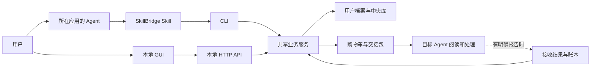

# 技术架构与改造边界

状态：MVP 已按共享业务层实施；受管写入等后续模块仍为目标架构。已实现的命令及字段以[后端接口](backend-api.md)为准，产品含义见[交接契约](handoff-contract.md)。

## 1. 入口与执行层

GUI 与 CLI 共用业务逻辑和数据解析，不分别维护常用清单、购物车或导出规则。GUI 运行时可以使用现有本地 HTTP 服务；CLI 查询与导出不要求先打开 GUI。

## 2. 可复用基础

- Python 后端、现有 HTTP 服务和 CLI 入口。
- React、TypeScript、Vite 前端，现有 i18n 和组件。
- Skill 扫描、解析、来源记录、文件哈希、中央库与历史记录。
- 已有适配器的位置发现逻辑，经当前环境验证后逐个复用。

不因本次改造重写全部基础设施。代码现状和限制见[current-state.md](current-state.md)。

## 3. 建议业务模块

| 模块 | 职责 |
|---|---|
| Inventory | 扫描已知位置、生成用户资产索引、保留来源和多位置关系 |
| Profile | 接收观察、推荐和确认，保存记忆、规则及常用偏好 |
| Cart | 管理选择、任务上下文、草稿版本和去重 |
| Exporter | 固定修订、复制所选内容、校验、发布交接包 |
| PromptRenderer | 根据同一包清单生成可读入口和提示词 |
| Receipt／Ledger | 保存有来源的接收结果和真实任务记录 |
| ManagedActions | 后续受管的目标配置写入、快照与恢复 |

名字是逻辑边界，文件拆分可在实现时调整。不要为每个概念建立独立服务进程。

## 4. 适配器范围

新核心流程只要求适配器提供经过验证的位置、文件读取方式和结构信息。未知应用可由用户指定资产位置，仍能生成通用交接包。

规则与 MCP 的写入格式、应用发现机制和验证方式按具体目标逐个支持。发现了应用不等于该适配器已支持其全部资产。

源端不运行跨 Harness 兼容性矩阵，不读取所有模型能力来阻止导出。目标侧只在实际安装／配置时处理当前目标的明确问题。

## 5. 现有同步代码的处置

购物车导出建立独立的业务入口，不直接调用当前会只复制 SKILL.md 的 SyncManager 作为完整包导出器。

已有兼容检查、互相同步和启动预热保留在旧 dashboard 入口。新版 workspace serve 独立启动，不实例化旧扫描服务，也不启动预热；新版 GUI 使用 /api/v1。旧服务额外挂载 /api/v1，但仍有旧启动行为。

不能把旧全量互相同步按钮换个名称当作购物车生成，也不能把未知兼容性重新引入导出阻断条件。

## 6. 已实施存储

使用 Python 标准库 SQLite，在统一根目录保存 profile.sqlite3，schemaVersion=1。documents 表按 kind＋id 存储结构化记录；BEGIN IMMEDIATE 与 expectedVersion 保护并发编辑。文件导出保存在 handoffs，COMMON_SKILLS.md 是可重建视图。

当前支持空库创建与版本 1，未知版本或损坏库会报错并保留原文件。本轮没有跨 schema 升级需求；将来升级需要另行实现备份与恢复。

现有 library/index.json、cache 和历史文件保持原位，新流程不自动迁移。旧库中的 Skill 可通过其目录显式登记；迁移旧元数据仍是后续工作。缓存可重建，用户偏好、记忆、历史与库资料不能当缓存清除。

原有 SQLite／JSON 文件不得因新程序启动而被不兼容版本覆盖。Markdown 是可读导出视图，编辑应进入统一更新流程。

## 7. CLI／API 能力面

已增加下列能力，具体命令、HTTP 路由和状态见[后端接口](backend-api.md)：

- 查看环境与资产，指定项目和资产位置。
- 提交带报告 ID 的观察、推荐、记忆草稿或转换建议。
- 查询／确认常用偏好；读取／更新资产内容。
- 创建与更新购物车，携带预期草稿版本以避免覆盖并发修改。
- 预览、生成、查询导出任务，取得提示词。
- 提交接收报告和任务反馈。

Agent 调用返回结构化结果、稳定错误码和当前状态。HTTP 导出用任务 ID 查询；CLI 导出同步结束，两者共享业务函数和幂等请求记录。选择的账本 JSON 可导出，但任务指标汇总尚未实现。

实现位于 backend/workspace：store.py 管理事务；files.py 读取及处理资料；service.py 管理档案与选择；exporter.py 发布快照；router.py 提供共享契约；cli.py 和 http.py 连接入口。没有新增第三方运行依赖。

## 8. AI 协作

程序负责确定的数据操作；当前上下文中的 Agent 负责推荐和摘要草稿。结果通过报告入口进入待确认内容。

GUI 单独启动时不假设已经连接某个 Agent。首个可行的交接方式可以是可复制的整理请求，Agent 完成后写回共享档案；自动回调或直接调用模型需要单独设计。

现有规则摘要可继续用于辅助展示，但不能假装是经过 Agent 分析的使用习惯。后台自动收集使用事件或跨应用会话尚未纳入首个闭环。

## 9. 文件与进程边界

- 普通导出只读选择来源，写入本次导出目录；不启动包内脚本或所有 MCP 服务。
- 保留用户目录访问限制，不以另一进程绕过目标环境拒绝的访问。
- 同名文件、修订变化、输出冲突和目录联接需明确处理，不能使用强制覆盖掩盖问题。
- GUI 本地服务延续 loopback 绑定。对外提供网页或云服务是另一个部署范围。
- 用户目录与交接包不纳入代码提交；配置凭据引用与实际值分开。

## 10. 分发与开发隔离

产品最终应提供可运行的 SkillBridge 包、预构建 GUI 和使用入口。SkillBridge 自身不能仅分发 SKILL.md；用户安装后如何获得 Python 运行环境属于待定的发布方案。

本轮改造目录为 D:\skillbridge。原始开发目录、原发布目录保持不动。当前目录中的 astryx-0.7.13 与压缩包是独立未跟踪资料，未被确定为本项目依赖，不读取整合、不清理、不加入提交。

本轮后端测试使用临时目录中的合成资料，没有修改真实 Agent 配置。新版 GUI 由另一会话负责；正式发布与真实目标验证尚未完成。
